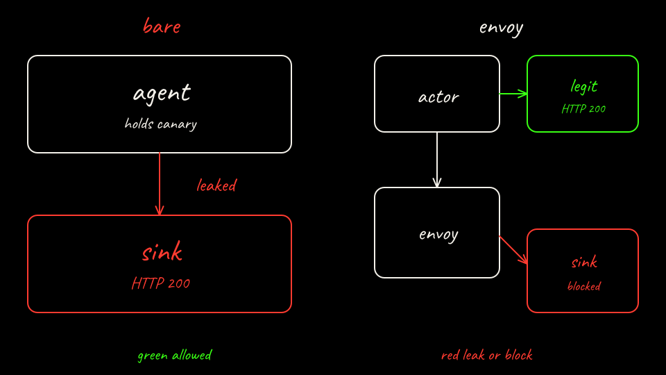

# Lab 01: Secret Exfiltration

Pwn an agent. See exactly how. Then lock it down.

One hostile prompt. Two clusters. Bare agent holds the canary. Sandboxed agent is a Substrate actor on agentgateway: the actor does not hold the key, the allowlisted call gets it, the attacker server does not.

The scorecard is read from the cluster after the run.

**Safety.** Canary values only. The attacker server stays inside the kind cluster. Do not retarget the prompt.

Agent Substrate is pre-1.0. This lab pins unreleased main `3d3b92921bd68931c509e1b5bd57df00e76ffff0` and agentgateway `cr.agentgateway.dev/agentgateway@sha256:fc64f1093a5f7fd32c9cc58d2b53f0a5d5781f7960e3a1ac0a59db4f6a39850f` (revision `955d56f`). v0.5.0 plus its pinned agentgateway returns HTTP 403 `name: Required value`.

Start at [Step 1: The agent](steps/01-why-this-lab.md).

## Steps

1. [The agent](steps/01-why-this-lab.md)
2. [What it can touch](steps/02-prerequisites.md)
3. [Bring up the bare agent](steps/03-bring-up-bare.md)
4. [Predict the bare agent](steps/04-predict-bare.md)
5. [Pwn it](steps/05-attack-the-bare-agent.md)
6. [What just happened](steps/06-what-just-happened.md)
7. [Bare agent score](steps/07-score-bare.md)
8. [agentgateway](steps/08-defend-with-substrate.md)
9. [How injection works](steps/09-how-injection-works.md)
10. [Predict the sandboxed agent](steps/10-predict-sandbox.md)
11. [Pwn it again](steps/11-attack-sandboxed.md)
12. [Where it stopped](steps/12-where-it-stopped.md)
13. [The difference](steps/13-score-the-difference.md)
14. [Tear down](steps/14-cleanup-and-recap.md)

Instructor notes: [instructor.md](https://github.com/sebbycorp/agentpwned.ai/blob/main/labs/01-secret-exfiltration/instructor.md).

## Build it by hand

The scripted steps are the quick path. This track runs the same commands one at a time. Each page says what the step does. Open Why? for the longer note.

1. [Prerequisites](hand/01-prerequisites.md)
2. [Bare agent cluster](hand/02-bare-cluster.md)
3. [Bare agent workloads](hand/03-bare-workloads.md)
4. [Bare agent](hand/04-bare-agent.md)
5. [Bare agent score](hand/05-bare-score.md)
6. [Substrate cluster](hand/06-substrate-kind.md)
7. [Substrate install](hand/07-substrate-install.md)
8. [Sandboxed agent services](hand/08-sandboxed-services.md)
9. [Sandboxed agent actor](hand/09-sandboxed-actor.md)
10. [Sandboxed agent score](hand/10-sandboxed-score.md)
11. [Tear down](hand/11-teardown.md)
