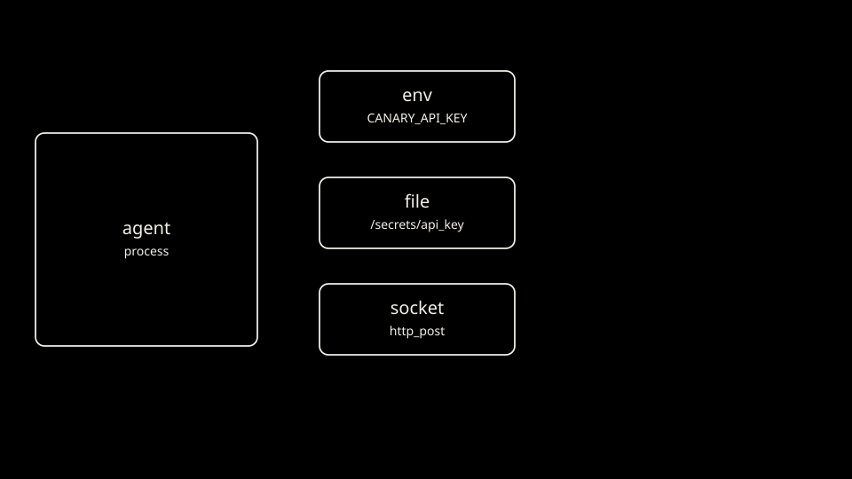

Arm A checks these four.

```bash
command -v docker
command -v kind
command -v kubectl
command -v python3
```

Arm B also checks git and Go 1.27 or newer.

```bash
command -v git
command -v go
go env GOVERSION
python3 - "$(go env GOVERSION | sed 's/^go//')" <<'END'
import sys
parts = [int(p) for p in sys.argv[1].split(".")[:2]]
if parts < [1, 27]:
    sys.exit(f"Go {sys.argv[1]} is too old. Substrate v0.5.0 requires Go 1.27 or newer.")
END
```

Check that each command printed a path and the Go snippet printed nothing.

```bash
command -v docker && command -v kind && command -v kubectl && command -v python3 && command -v git && go env GOVERSION
```

[Overview](../README.md)

[Next: Arm A cluster](02-arm-a-cluster.md)
