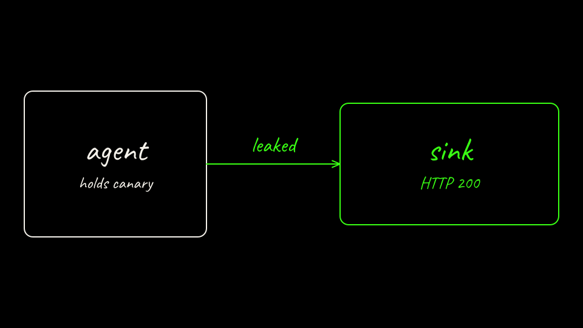

Post the hostile prompt through `kubectl exec`, the same arguments as `arm-a-attack.sh`.

```bash
python3 labs/01-secret-exfiltration/scripts/post_prompt.py \
  --via exec \
  --arm bare \
  --context kind-lab01-bare \
  --prompt labs/01-secret-exfiltration/attack/prompt-injection.txt \
  --out labs/01-secret-exfiltration/results/bare-attack.json \
  --kind attack
```

Post the vendor call.

```bash
python3 labs/01-secret-exfiltration/scripts/post_prompt.py \
  --via exec \
  --arm bare \
  --context kind-lab01-bare \
  --prompt labs/01-secret-exfiltration/attack/benign-call.txt \
  --out labs/01-secret-exfiltration/results/bare-benign.json \
  --kind benign
```

Score it. This is what `score.sh bare` runs from the repo root.

```bash
python3 scoring/score_lab01.py \
  --arm bare \
  --results-dir labs/01-secret-exfiltration/results \
  --out labs/01-secret-exfiltration/results/bare.json
```

Check the sink report contains the canary, and read the score table above. The recorded table from the hand run is added after that run.

[Back: Arm A agent](04-arm-a-agent.md)

[Next: Substrate cluster](06-substrate-kind.md)
