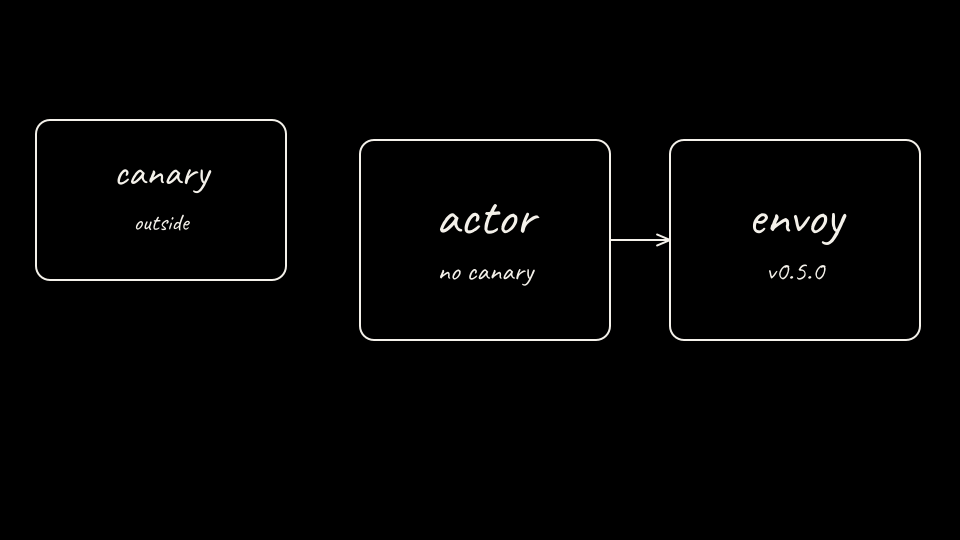

`arm-b-up.sh` deletes `lab01-bare` so this machine has room for Substrate.

```bash
if kind get clusters 2>/dev/null | grep -qx lab01-bare; then
  kind delete cluster --name lab01-bare || true
fi
```

Clone v0.5.0 when the checkout has no `.git` directory. The default path is `$HOME/.cache/agentpwned/substrate`.

```bash
export SUBSTRATE_REF="${SUBSTRATE_REF:-v0.5.0}"
export SUBSTRATE_SRC="${SUBSTRATE_SRC:-${HOME}/.cache/agentpwned/substrate}"
if [[ ! -d "${SUBSTRATE_SRC}/.git" ]]; then
  mkdir -p "$(dirname "${SUBSTRATE_SRC}")"
  git clone --depth 1 --branch "${SUBSTRATE_REF}" https://github.com/agent-substrate/substrate.git "${SUBSTRATE_SRC}"
fi
git -C "${SUBSTRATE_SRC}" rev-parse HEAD
```

Create the kind cluster and the local registry. The script runs this with no extra flags. It deletes an existing cluster named `kind`.

```bash
( cd "${SUBSTRATE_SRC}" && hack/create-kind-cluster.sh )
```

Same nftables branch as Arm A, on context `kind-kind`.

```bash
matches="$(docker exec kind-control-plane cat /proc/net/ip_tables_matches 2>/dev/null || true)"
printf '%s\n' "${matches}"
if ! printf '%s\n' "${matches}" | grep -qx 'statistic'; then
  mode="$(kubectl --context kind-kind -n kube-system get configmap kube-proxy -o jsonpath='{.data.config\.conf}' | awk '/^mode:/{print $2; exit}')"
  echo "kube-proxy mode: ${mode}"
  if [[ "${mode}" != "nftables" ]]; then
    kubectl --context kind-kind -n kube-system get configmap kube-proxy -o json \
      | python3 -c 'import json,sys; cm=json.load(sys.stdin); cm["data"]["config.conf"]=cm["data"]["config.conf"].replace("mode: iptables","mode: nftables",1); json.dump(cm, sys.stdout)' \
      | kubectl --context kind-kind apply -f -
    kubectl --context kind-kind -n kube-system delete pod -l k8s-app=kube-proxy --wait=false
    kubectl --context kind-kind -n kube-system rollout status daemonset/kube-proxy --timeout=180s
  fi
fi
```

Check the node.

```bash
kubectl --context kind-kind get nodes
docker inspect -f '{{.State.Running}}' kind-registry
```

[Back: Arm A score](05-arm-a-score.md)

[Next: Substrate install](07-substrate-install.md)
