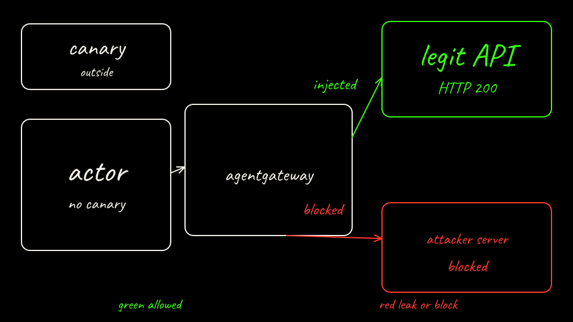

<p class="because"><b>What this does.</b> Push the lab image, pin the agentgateway digest, then run the two install commands with <code>--atenet-dataplane=agentgateway</code>. <b>Why it matters.</b> agentgateway is the proxy on the actor's way out, and the actor will not hold the canary. The <code>k8s.io</code> provider is what reads the Secret later, when the gateway replaces a header.</p>
<details class="why">
<summary>Why?</summary>
<p><code>--deploy-ate-system</code> installs the control plane and the egress gateway. <code>--atenet-dataplane=agentgateway</code> selects ingress and egress together. This commit is pre-1.0. Its kustomize file still names an older alpha image, so both image lines are rewritten to digest <code>sha256:fc64f1093a5f7fd32c9cc58d2b53f0a5d5781f7960e3a1ac0a59db4f6a39850f</code> (revision <code>955d56f</code>, PR 3990) before install. v0.5.0 plus its pinned image returns HTTP 403 <code>name: Required value</code>. <code>--credential-provider='{"name":"k8s.io"}'</code> selects the Kubernetes Secret provider. <code>--deploy-demo-egress</code> publishes the worker image and a WorkerPool labeled <code>workload=egress</code>. The hostPort loop runs only when the iptables multiport match is missing. Substrate dials the atelet pod IP.</p>
</details>

Build and push the actor image to the kind registry. Keep the digest line. The actor template needs `localhost:5001/lab01-agent@` plus that digest. The digest pins the bytes you pushed. A tag can move.

```bash
export SUBSTRATE_SRC="${SUBSTRATE_SRC:-${HOME}/.cache/agentpwned/substrate}"
docker build -t localhost:5001/lab01-agent:local labs/01-secret-exfiltration/agent
push_log="$(docker push localhost:5001/lab01-agent:local)"
printf '%s\n' "${push_log}"
digest="$(printf '%s\n' "${push_log}" | awk '/digest: sha256:/ {print $3}' | tail -1)"
echo "Actor image localhost:5001/lab01-agent@${digest}"
test -n "${digest}"
```

Pin both agentgateway image lines, then export the build settings. The floating `latest-dev` tag is not the pin.

```bash
export AGENTGATEWAY_IMAGE="${AGENTGATEWAY_IMAGE:-cr.agentgateway.dev/agentgateway@sha256:fc64f1093a5f7fd32c9cc58d2b53f0a5d5781f7960e3a1ac0a59db4f6a39850f}"
python3 - "${SUBSTRATE_SRC}/manifests/ate-install/components/agentgateway/kustomization.yaml" "${AGENTGATEWAY_IMAGE}" <<'END'
import pathlib, sys
path, image = sys.argv[1:]
file = pathlib.Path(path)
lines = file.read_text().splitlines(keepends=True)
count = 0
out = []
for line in lines:
    stripped = line.lstrip()
    if stripped.startswith("image: cr.agentgateway.dev/agentgateway"):
        indent = line[: len(line) - len(stripped)]
        newline = "\n" if line.endswith("\n") else ""
        out.append(f"{indent}image: {image}{newline}")
        count += 1
    else:
        out.append(line)
if count != 2:
    sys.exit(f"expected 2 agentgateway image lines, found {count}")
file.write_text("".join(out))
print(f"pinned {count} agentgateway image lines")
END
export KO_DOCKER_REPO="${KO_DOCKER_REPO:-localhost:5001}"
export GOMAXPROCS="${GOMAXPROCS:-2}"
export PATH="/usr/local/go/bin:${HOME}/.local/bin:${PATH}"
```

Kernels without the iptables `multiport` match cannot start atelet while it publishes a hostPort. The script drops that hostPort in the background while the installer applies the DaemonSet. Substrate dials the atelet pod IP.

```bash
matches="$(docker exec kind-control-plane cat /proc/net/ip_tables_matches 2>/dev/null || true)"
if ! printf '%s\n' "${matches}" | grep -qx multiport; then
  (
    for _ in $(seq 1 400); do
      host_port="$(kubectl --context kind-kind -n ate-system get ds atelet -o jsonpath='{.spec.template.spec.containers[0].ports[0].hostPort}' 2>/dev/null || true)"
      if [[ -n "${host_port}" ]]; then
        kubectl --context kind-kind -n ate-system patch ds atelet --type json \
          -p '[{"op":"remove","path":"/spec/template/spec/containers/0/ports/0/hostPort"}]' >/dev/null
        echo "removed atelet hostPort ${host_port}"
      fi
      sleep 2
    done
  ) &
fi
```

Install the system, then the egress demo. These are the flags `arm-b-up.sh` passes.

```bash
(
  cd "${SUBSTRATE_SRC}"
  hack/install-ate-kind.sh \
    --deploy-ate-system \
    --atenet-dataplane=agentgateway \
    --credential-provider='{"name":"k8s.io"}' \
    --rollout-timeout=15m
  hack/install-ate-kind.sh --deploy-demo-egress --rollout-timeout=15m
)
```

Install `kubectl-ate` and shrink the worker pool to one replica.

```bash
mkdir -p "${HOME}/.local/bin"
( cd "${SUBSTRATE_SRC}" && GOBIN="${HOME}/.local/bin" go install ./cmd/kubectl-ate )
kubectl --context kind-kind -n ate-demo-egress patch workerpool egress \
  --type merge -p '{"spec":{"replicas":1}}'
```

Check the egress Deployment and the worker pool.

```bash
kubectl --context kind-kind -n ate-system get deploy atenet-egress
kubectl --context kind-kind -n ate-demo-egress get workerpool egress
```

The kind run pastes the egress Deployment and the worker pool here. The egress container image must be the digest above, and the container name is `agentgateway`.

[Back: Substrate cluster](06-substrate-kind.md)

[Next: Arm B services](08-arm-b-services.md)
