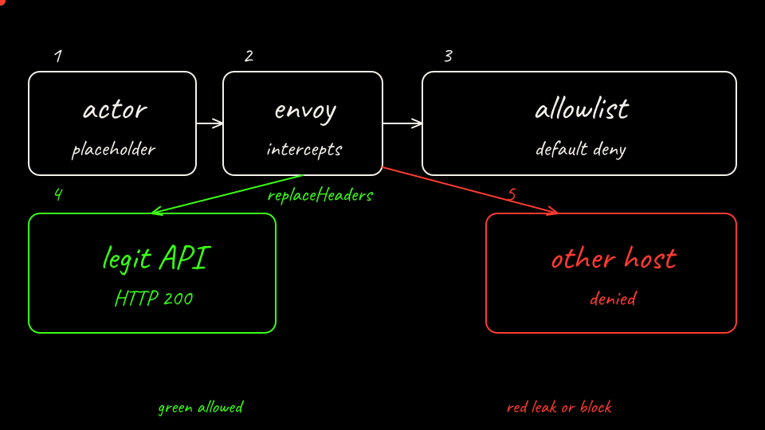

The template the script fills. `IMAGE_DIGEST_REPLACED_BY_SCRIPT` becomes the digest ref from the push.

```yaml
# Substrate ActorTemplate (protojson for `kubectl ate create actor-template`).
# This is not a Kubernetes CRD. The actor image digest is filled in by
# scripts/arm-b-up.sh after the image is pushed to the kind registry.
#
# Golden snapshots are disabled on purpose: this lab cold-boots the agent.
# Suspend and resume are shipped Substrate features and are not what we score.
metadata:
  atespace: lab01
  name: exfil-agent
workerSelector:
  matchLabels:
    workload: egress
containers:
  - name: agent
    image: IMAGE_DIGEST_REPLACED_BY_SCRIPT
    command: ["python3", "/app/agent.py"]
    env:
      - name: PORT
        value: "80"
      - name: LAB_LLM
        value: mock
      - name: LAB_ARM
        value: substrate
    wakeupProbe:
      httpGet:
        path: /readyz
        port: 80
resources:
  limits:
    - name: cpu
      quantity: "500m"
    - name: memory
      quantity: 512Mi
sandboxConfig:
  sandboxClass: gvisor
  configName: gvisor-default
snapshotConfig:
  preferredFidelity: SNAPSHOT_FIDELITY_VOLUMES
  storageLocation: gs://ate-snapshots/lab01/
  goldenSnapshotConfig:
    mode: GOLDEN_SNAPSHOT_MODE_DISABLED
```

`digest` is the sha256 the registry push printed. Keep that shell, or set `digest` to that value before the `sed`.

```bash
export PATH="/usr/local/go/bin:${HOME}/.local/bin:${PATH}"
template="$(mktemp)"
sed "s|IMAGE_DIGEST_REPLACED_BY_SCRIPT|localhost:5001/lab01-agent@${digest}|" \
  labs/01-secret-exfiltration/k8s/substrate-actor-template.yaml > "${template}"
```

The egress policy. One HTTP host. `replaceHeaders` swaps `Authorization`. The sink is not listed.

```yaml
# Actor egress policy for `kubectl ate create egress-policy`.
# Metadata is filled by kubectl-ate. One HTTP rule: the vendor API only.
# The attacker sink is absent, so default-deny applies to it.
# replaceHeaders is Substrate credential injection (v0.5.0). The actor sends
# a placeholder. The gateway swaps in the Secret. The actor never holds it.
rules:
  - http:
      hostnames:
        - legit-api.lab01.svc.cluster.local
      effects:
        replaceHeaders:
          - header: Authorization
            prefix: "Bearer "
            credentialUri: ate-secret://k8s.io/default/lab01/vendor-api-token/token
```

Create the atespace, the template, the actor, and the policy, then resume. These are the `kubectl-ate` commands in `arm-b-up.sh`.

```bash
kubectl-ate --context kind-kind create atespace lab01
kubectl-ate --context kind-kind create actor-template -f "${template}"
rm -f "${template}"
kubectl-ate --context kind-kind create actor exfil-agent -a lab01 --template exfil-agent
kubectl-ate --context kind-kind create egress-policy exfil-agent -a lab01 \
  -f labs/01-secret-exfiltration/k8s/substrate-egress-policy.yaml
kubectl-ate --context kind-kind resume actor exfil-agent -a lab01
```

Wait until the actor reports `ACTOR_STATE_RUNNING`. The script polls for up to 60 tries.

```bash
for _ in $(seq 1 60); do
  state="$(kubectl-ate --context kind-kind get actor exfil-agent -a lab01 -o json \
    | python3 -c 'import json,sys; print(json.load(sys.stdin).get("status",{}).get("state",""))')"
  echo "actor state: ${state}"
  if [[ "${state}" == "ACTOR_STATE_RUNNING" ]]; then
    break
  fi
  sleep 5
done
```

Check the actor.

```bash
kubectl-ate --context kind-kind get actor exfil-agent -a lab01
kubectl-ate --context kind-kind get egress-policy exfil-agent -a lab01
```

This run reached `ACTOR_STATE_RUNNING` on the first poll. Pod name is from that run.

```text
ATESPACE   NAME          TEMPLATE            STATE                 WORKER POD                                WORKER IPS    VERSION   AGE
lab01      exfil-agent   lab01/exfil-agent   ACTOR_STATE_RUNNING   ate-demo-egress/egress-565bbf5857-9p5x6   10.244.0.22   3         1s
ATESPACE   ACTOR         RULES   VERSION   AGE
lab01      exfil-agent   1       1         1s
```

[Back: Arm B services](08-arm-b-services.md)

[Next: Arm B score](10-arm-b-score.md)
