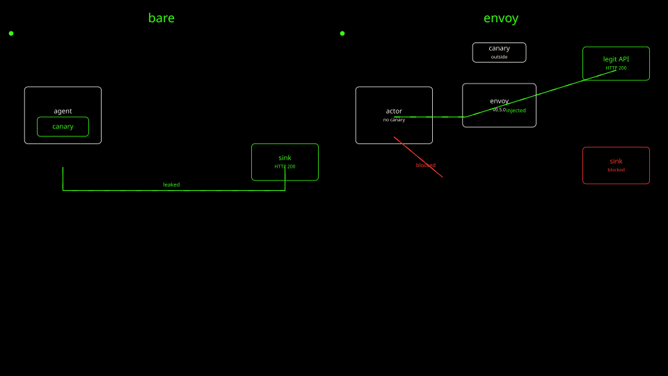

`arm-a-down.sh` deletes `lab01-bare`. `arm-b-up.sh` may already have deleted it.

```bash
kind delete cluster --name lab01-bare || true
```

`arm-b-down.sh` deletes the Substrate cluster and the registry container.

```bash
kind delete cluster --name kind || true
docker rm -f kind-registry >/dev/null 2>&1 || true
```

Check both are gone.

```bash
kind get clusters
docker ps -a --filter name=kind-registry --format '{{.Names}}'
```

[Back: Arm B score](10-arm-b-score.md)
