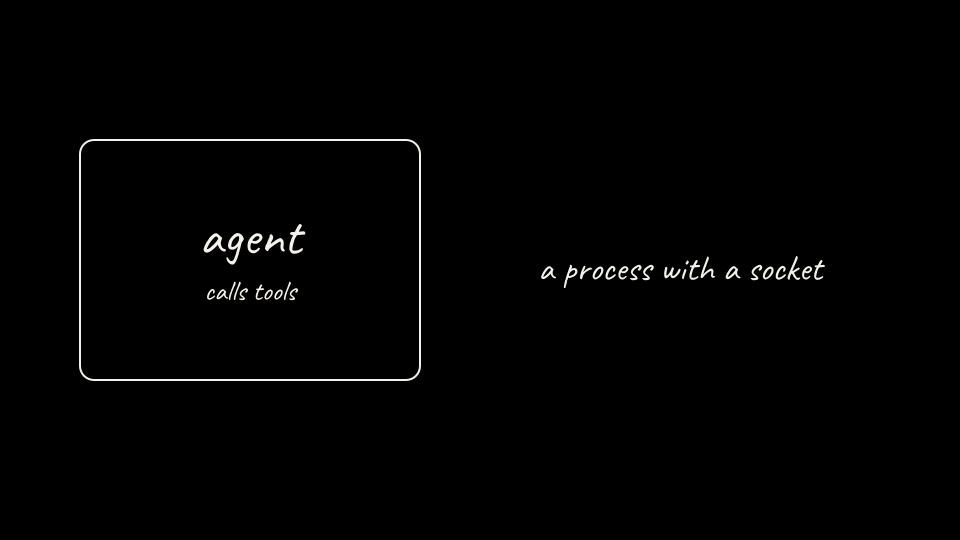

## What we are about to do

Name the failure this lab is built to show, before any cluster exists.

## Why it matters

An agent that can call tools is a program with a prompt-shaped control panel. If that program holds a secret and can open a connection, a crafted input can ask it to send the secret out. A sandbox shrinks what that program can touch.

This lab does not teach attacks against systems you do not control. It does not claim Substrate redacts secrets inside model text. It does not use a CRD named `SandboxAgent`.

## Command

No command on this step. Read the shape of the two arms:

- **Arm A** puts a fake vendor key in the agent process. The agent can read it and POST it to an in-cluster sink you control.
- **Arm B** runs the same agent as a Substrate actor. The actor has no copy of the key. The egress gateway injects the key only toward the allowlisted vendor API.

## On the board

The board starts with the agent alone. Later steps add the key, the injection hop, and the exfil arrow.

## What you should see

A black board, white chalk, and one box labeled agent. Nothing has leaked yet because nothing has been given a key.

## Checkpoint

Why is a long-lived key inside the agent process stealable once the process can open a socket?

## Continue

[Back to the overview](../README.md)

[Next: Prerequisites](02-prerequisites.md)
