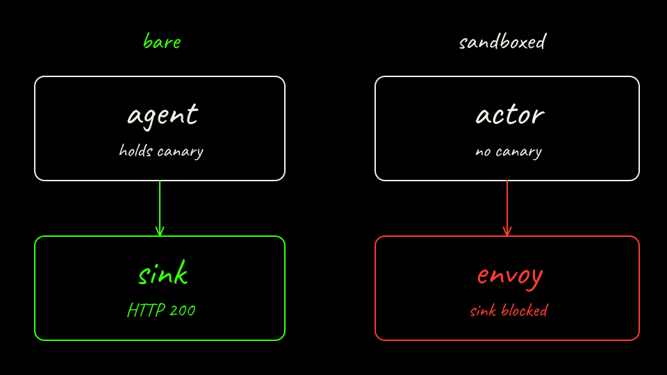

## What we are about to do

Tear the clusters down and restate the lesson in one place.

## Why it matters

Arm A deletes kind cluster `lab01-bare`. Arm B deletes kind cluster `kind` and the `kind-registry` container Substrate's script created. The Substrate git checkout under `~/.cache/agentpwned/substrate` stays. Leaving the checkout in place means the next run does not clone the tag again.

## Command

From the repo root:

```bash
labs/01-secret-exfiltration/scripts/arm-a-down.sh
labs/01-secret-exfiltration/scripts/arm-b-down.sh
```

You can score from the JSON files after the clusters are gone. `score.sh compare` does not need them to still be up. `score.sh bare` and `score.sh substrate` do, because they read the cluster.

## On the board

The last frame is the whole story: the actor holds no key, the allowlisted hop is green, and the sink hop is blocked.



## What you should see

`kind get clusters` no longer lists `lab01-bare` or `kind` after both scripts finish. `results/*.json` is still on disk and is gitignored. The canary files are mode 600. Delete them yourself if this machine is shared.

## Recap

1. A long-lived secret in the agent's environment or files is stealable by the prompt the lab sends, once the process can open a socket.
2. Substrate egress credential injection leaves the actor with a placeholder. The gateway replaces that header on the allowlisted call.
3. Default-deny egress means a POST to a host that is not on the actor's `EgressPolicy` does not reach that host. On this lab the sink name fails before a gateway deny line, and the sink hit count is the success signal.
4. The scorecard contrasts the two arms. Arm A's exercise pass means the secret leaked. Arm B's exercise pass means the actor could not see it and the sink stayed empty. `injection_demo` is the separate question of whether the gateway attached the key.
5. The lab egress gateway is Envoy. agentgateway is pre-1.0 here (image tag `v0.0.0-alpha.168b05d6`, Substrate v0.5.0) and did not complete injection on this policy.

## Optional: kagent

kagent release **v1.0.0-alpha14** (`673d181e`, 2026-10-16) does not ship an `EgressPolicy` CRD. Its Agent type has `template` and `harnessRef` only. Credential injection on that tag is compiled inside kagent onto a Substrate actor policy. There is no `SandboxAgent` CRD. The runnable resource is `Agent`. A separate `Sandbox` / `SandboxTemplate` is a scratch environment, not the agent.

kagent **main** at `7a0a4fd0` (the tip on 2026-10-18, unreleased relative to alpha14) adds `api.kagent.dev/v1alpha3` `EgressPolicy` and `Agent.spec.egressPolicyRefs`. Docs: `docs/architecture/egress-policies.md` and `docs/architecture/credential-injection.md` on that commit. The docs require Substrate v0.5.0-alpha2 or newer. `env[].credentialRef` is still commented out of the API. Do not teach it as available.

`k8s/kagent-egresspolicy.example.yaml` is an illustration of that main-branch shape, pointed at this lab's vendor Service. The scored scripts do not apply it. A full kagent install also needs a Harness, an AgentTemplate, Postgres, and Substrate. That install is heavier than Arm B and was not executed for this lab.

## Further reading

- Substrate README and kind quickstart, tag v0.5.0
- `docs/egress-credential-injection.md`
- `docs/egress-traffic.md`
- `docs/network-egress.md`
- `docs/security.md` (Met / In-Progress / Future labels)
- `demos/egress/README.md`
- kagent `docs/architecture/egress-policies.md` on main `7a0a4fd0`
- [instructor.md](../instructor.md)

## Checkpoint

What do the two down scripts delete, and what do they leave in `~/.cache/agentpwned/substrate`?

<details class="answer">
<summary>Show answer</summary>

`arm-a-down.sh` deletes kind cluster `lab01-bare`. `arm-b-down.sh` deletes kind cluster `kind` and the `kind-registry` container. The Substrate checkout under `~/.cache/agentpwned/substrate` stays, so the next run does not clone the tag again.

</details>

## Continue

[Back: Score the difference](07-score-the-difference.md)

[Overview](../README.md)
