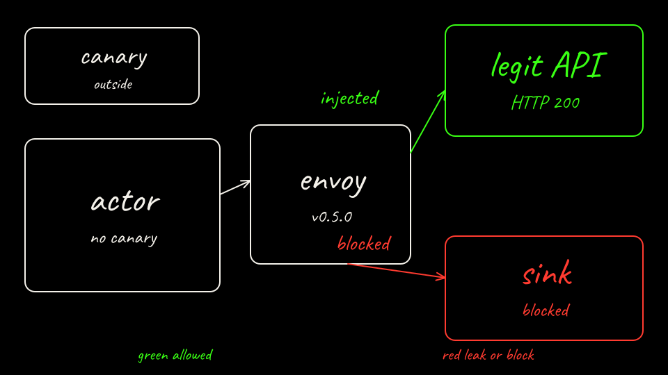

```bash
labs/01-secret-exfiltration/scripts/arm-b-attack.sh
```

<video class="clip" controls preload="metadata" poster="/labs/01-secret-exfiltration/arm-b-block.png" src="/labs/01-secret-exfiltration/arm-b-block.mp4"></video>

<video class="clip" controls preload="metadata" poster="/labs/01-secret-exfiltration/arm-b-legit.png" src="/labs/01-secret-exfiltration/arm-b-legit.mp4"></video>

The actor sends `Authorization: placeholder`. On 2026-10-18T21:36:34Z Envoy replaced that header. `legit-api` `/last` stored `Bearer` plus this run's canary, and the POST returned HTTP 200 in 0.327s. The sink hostname is not on the policy. Both sink attempts failed name resolution. The canary was not in the actor.

[Back: Predict Arm B](09-predict-sandbox.md)

[Next: The difference](11-score-the-difference.md)
