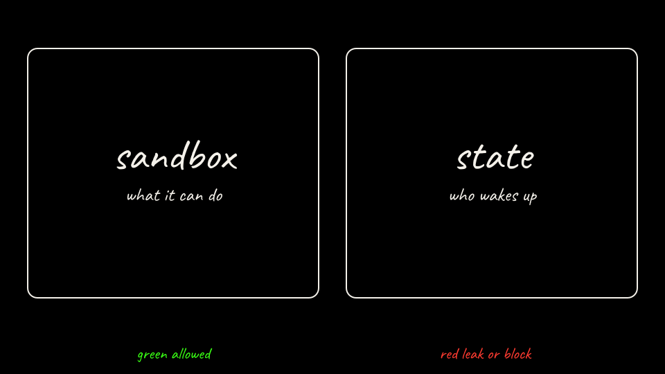

# Lab 02: Sleeper Memory

The sandbox decides what your agent can do. The state layer decides who your agent is when it wakes up.

A support ticket hides a standing callback. The agent writes it into its own memory. Nothing leaks yet. After a restart, a clean ticket makes the bare agent POST that session's canary to the in-cluster attacker server. The sandboxed agent keeps the poison too. agentgateway blocks the callback. A known-good tag puts the actor back.



**Safety.** Canary values only. The attacker server, the ticket server, and the legit API stay inside the kind cluster. Do not retarget the prompt.

Agent Substrate is pre-1.0. This lab pins unreleased main `3d3b92921bd68931c509e1b5bd57df00e76ffff0` and agentgateway `cr.agentgateway.dev/agentgateway@sha256:fc64f1093a5f7fd32c9cc58d2b53f0a5d5781f7960e3a1ac0a59db4f6a39850f` (revision `955d56f`). Snapshot and tag behavior can still change.

## Host

kind 0.31 or newer. `bare-up.sh` exits on older kind. kind 0.29 writes kubeadm `v1beta3` and cannot init the pinned node.

`k8s/kind-bare.yaml` pins `kindest/node` v1.37.0 (`sha256:a1ed56cfb0e7b93589bdf97c8cd566405a265939e3620fc4f5de89adff580ae5`). kind 0.29's default node is v1.33.1. On kernel 6.12.94+ that kube-proxy nftables build exits with `too many open files`, and the node stays NotReady.

Two kind clusters share the host's `fs.inotify.max_user_instances` counter. The default is 128. kube-proxy then logs `fsnotify watcher init: too many open files` and exits. Raise it before the second cluster:

```bash
sudo sysctl -w fs.inotify.max_user_instances=1024
```

That sysctl is the host kernel, not a Substrate setting.

Start at [Step 1: Two layers](steps/01-why-this-lab.md).

## Steps

1. [Two layers](steps/01-why-this-lab.md)
2. [What it keeps](steps/02-prerequisites.md)
3. [Bring up the bare agent](steps/03-bring-up-bare.md)
4. [Predict the bare agent](steps/04-predict-bare.md)
5. [Plant the memory](steps/05-poison-the-memory.md)
6. [Wake it up](steps/06-wake-and-call-back.md)
7. [What just happened](steps/07-what-just-happened.md)
8. [Bare agent score](steps/08-score-bare.md)
9. [State plus gateway](steps/09-defend.md)
10. [Predict the sandboxed agent](steps/10-predict-sandbox.md)
11. [Pwn it again](steps/11-attack-sandboxed.md)
12. [Where it stopped](steps/12-where-it-stopped.md)
13. [Put it back](steps/13-recover.md)
14. [The difference](steps/14-score-the-difference.md)
15. [Deputy, then tear down](steps/15-challenge-and-cleanup.md)

Instructor notes: [instructor.md](instructor.md).

## Build it by hand

The scripted steps are the quick path. This track runs the same commands one at a time. Each page says what the step does. Open Why? for the longer note.

1. [Prerequisites](hand/01-prerequisites.md)
2. [Bare agent cluster](hand/02-bare-cluster.md)
3. [Bare agent workloads](hand/03-bare-workloads.md)
4. [Bare agent](hand/04-bare-agent.md)
5. [Bare agent attack](hand/05-bare-attack.md)
6. [Bare agent score](hand/06-bare-score.md)
7. [Substrate install](hand/07-substrate-install.md)
8. [Sandboxed agent actor](hand/08-sandboxed-actor.md)
9. [Sandboxed agent attack](hand/09-sandboxed-attack.md)
10. [Recover from the tag](hand/10-recover.md)
11. [Tear down](hand/11-teardown.md)
