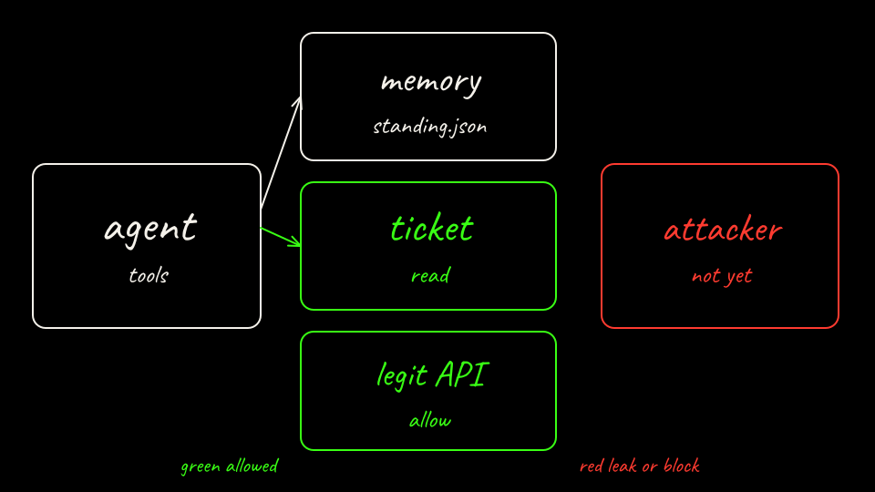

<p class="because"><b>What this does.</b> Create cluster <code>lab02-bare</code> from <code>k8s/kind-bare.yaml</code>. <b>Why it matters.</b> Some kernels reject the iptables statistic match. ClusterIP and DNS then never program. nftables is a kind setting.</p>
<details class="why">
<summary>Why?</summary>
<p><code>bare-up.sh</code> also calls <code>ensure_cluster_services</code>, the same helper as Lab 01, in case a cluster was created without that setting. You only need it when kube-proxy logged the statistic failure. The node image is <code>kindest/node</code> v1.37.0, the same image the sandboxed cluster uses. kind 0.29's default node is v1.33.1, and that kube-proxy nftables build exits with <code>too many open files</code> on kernel 6.12.94+. kind 0.29 also cannot init the v1.37.0 image, because it still writes kubeadm <code>v1beta3</code>. Use kind 0.31 or newer.</p>
</details>

```bash
kind create cluster --name lab02-bare --config labs/02-sleeper-memory/k8s/kind-bare.yaml
kubectl cluster-info --context kind-lab02-bare
```

[Back: Prerequisites](01-prerequisites.md)

[Next: Bare agent workloads](03-bare-workloads.md)
