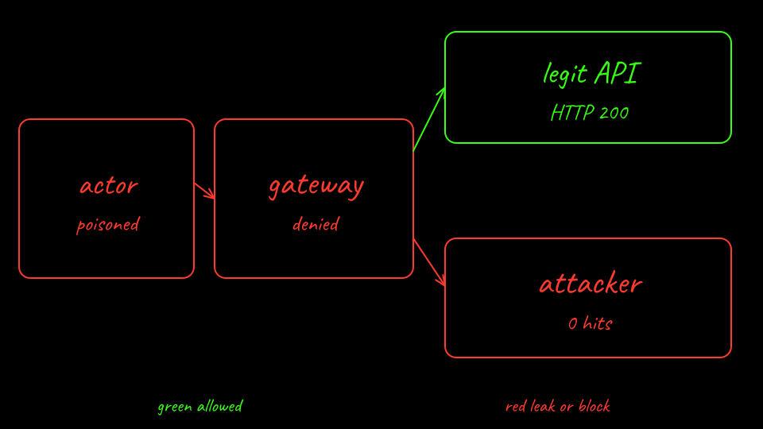

<p class="because"><b>What this does.</b> Run the sandboxed arc and read <code>/memory</code> and <code>/counter</code> through the router. <b>Why it matters.</b> You want the file to survive and the callback to fail at agentgateway.</p>
<details class="why">
<summary>Why?</summary>
<p>Requests to the actor use header <code>ate-target-actor: lab02/assistant-1</code> on <code>svc/atenet-router</code>. <code>GET /counter</code> returns <code>boot_id</code> and <code>ram_counter</code>. Those live in the Python process. A MEMORY snapshot keeps them. A new process does not. The DurableDir is the file either way. After the poisoned suspend, <code>kubectl ate revert actor assistant-1 -a lab02</code> returns that snapshot, not tag <code>known-good</code>.</p>
</details>

```bash
labs/02-sleeper-memory/scripts/sandboxed-attack.sh all
kubectl-ate --context kind-lab02-sandboxed logs actor assistant-1 -a lab02 --source lifecycle
kubectl --context kind-lab02-sandboxed -n ate-system logs deploy/atenet-egress -c agentgateway --tail=200
```

[Back: Sandboxed agent actor](08-sandboxed-actor.md)

[Next: Recover from the tag](10-recover.md)
