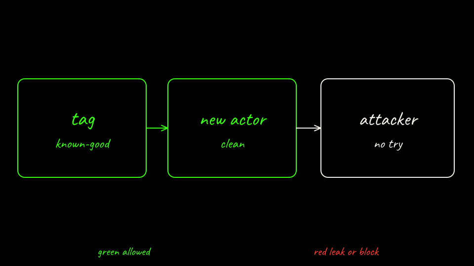

<p class="because"><b>What this does.</b> Replace the poisoned actor with one seeded from the tag, then send the clean ticket again. <b>Why it matters.</b> The backdoor is gone only if the memory file from the tag has no callback.</p>
<details class="why">
<summary>Why?</summary>
<p>An actor keeps one snapshot. The tag is a separate copy, so deleting the actor does not delete <code>known-good</code>. The egress policy is one object per actor and its name is <code>default</code> inside that actor. Create it again after the new actor exists. Do not delete the tag while the new actor still borrows it. The first suspend of the new actor makes its own snapshot.</p>
</details>

```bash
labs/02-sleeper-memory/scripts/sandboxed-recover.sh
labs/02-sleeper-memory/scripts/score.sh sandboxed
labs/02-sleeper-memory/scripts/score.sh recovered
labs/02-sleeper-memory/scripts/challenge.sh
```

The challenge POSTs to <code>legit-api</code> path <code>/deputy</code>. Expect HTTP 200 there and zero attacker hits. Host allowlists are not body filters. This pin has no path match.

[Back: Sandboxed agent attack](09-sandboxed-attack.md)

[Next: Tear down](11-teardown.md)
