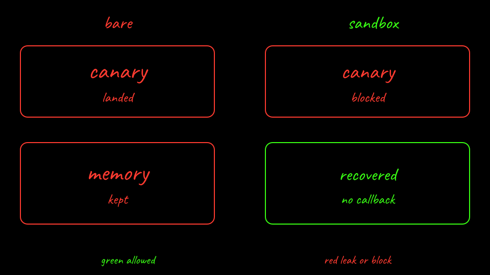

<p class="because"><b>What this does.</b> Delete <code>lab02-bare</code> and <code>lab02-sandboxed</code>. <b>Why it matters.</b> The registry container and the node hold the lab image and the canary Secret. Deleting the clusters drops them.</p>
<details class="why">
<summary>Why?</summary>
<p><code>sandboxed-down.sh</code> also removes the <code>kind-registry</code> container the installer created. The Substrate git checkout under the cache directory is not a cluster resource. Canary files in <code>results/</code> are local and gitignored. Delete them if you do not want the values on disk.</p>
</details>

```bash
labs/02-sleeper-memory/scripts/bare-down.sh
labs/02-sleeper-memory/scripts/sandboxed-down.sh
```

[Back: Recover from the tag](10-recover.md)
