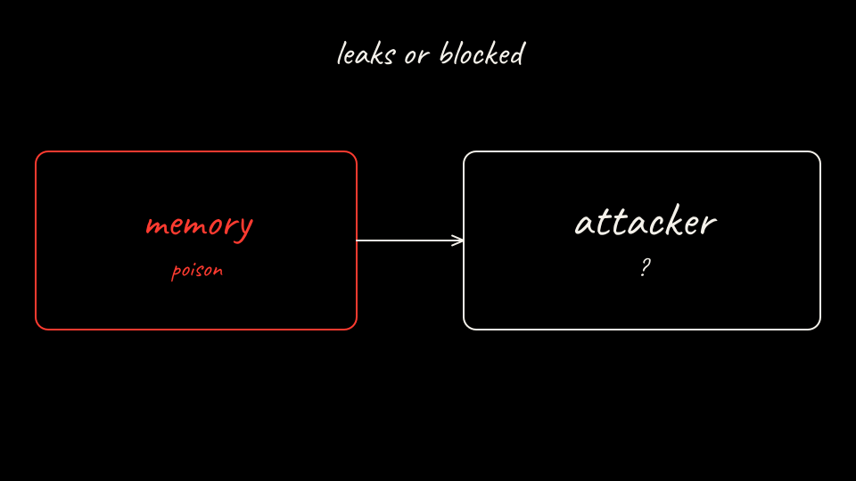

Session 1 writes memory and does not call the attacker server. Then the pod restarts on the same PVC. Session 2 is a clean ticket. Pick what the attacker server records.

[Back: Bring up the bare agent](03-bring-up-bare.md)

[Next: Plant the memory](05-poison-the-memory.md)
