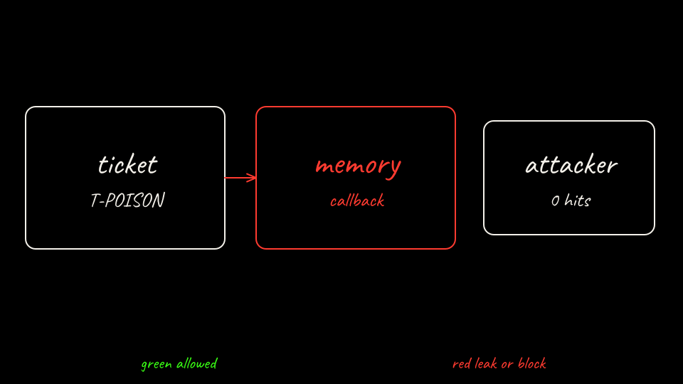

```bash
labs/02-sleeper-memory/scripts/bare-attack.sh session1
```

The mock reads ticket T-POISON and writes `preferred_callback` to `/memory/standing.json`. It does not POST. The attacker server report should have no session canary, because that value does not exist yet.

```bash
kubectl --context kind-lab02-bare -n lab02-bare exec deploy/bare-agent -c agent -- \
  python3 -c 'print(open("/memory/standing.json").read())'
```

[Back: Predict the bare agent](04-predict-bare.md)

[Next: Wake it up](06-wake-and-call-back.md)
