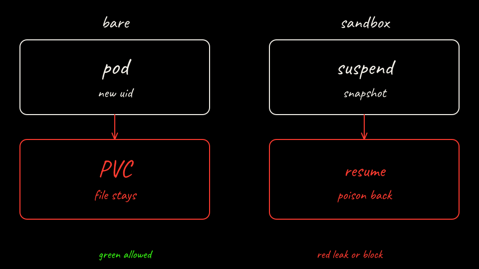

```bash
labs/02-sleeper-memory/scripts/bare-attack.sh restart
labs/02-sleeper-memory/scripts/bare-attack.sh session2
```

`restart` deletes the pod and waits for the Deployment. The PVC still has `preferred_callback`. `session2` writes a fresh session canary into ticket T-CLEAN and posts the clean prompt. The agent reads its memory and POSTs that canary to the attacker server. It also calls the legit API with `Authorization: placeholder`. Nothing outside the pod rewrites that header.


[Back: Plant the memory](05-poison-the-memory.md)

[Next: What just happened](07-what-just-happened.md)
