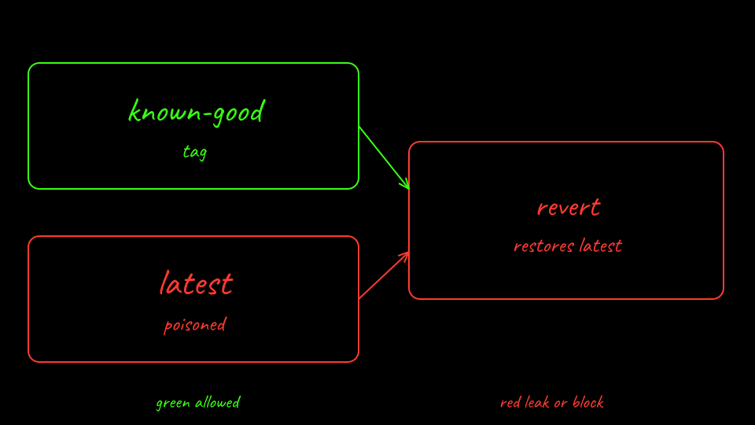
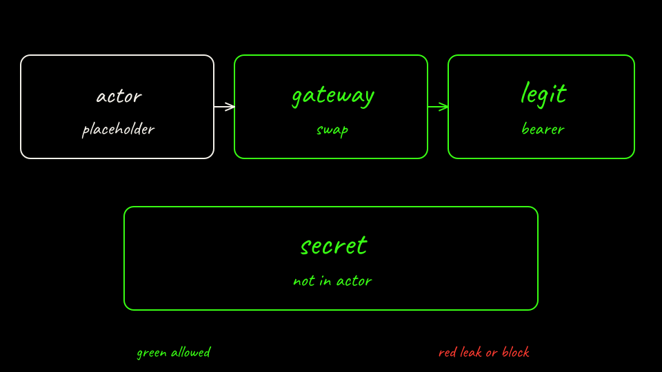

```bash
labs/02-sleeper-memory/scripts/sandboxed-up.sh
```

This installs Agent Substrate main `3d3b929` with `--atenet-dataplane=agentgateway` and `--credential-provider='{"name":"k8s.io"}'`. The egress image is `cr.agentgateway.dev/agentgateway@sha256:fc64f1093a5f7fd32c9cc58d2b53f0a5d5781f7960e3a1ac0a59db4f6a39850f` (revision `955d56f`). Both are pre-1.0.

The template sets `preferredFidelity: SNAPSHOT_FIDELITY_MEMORY` and a DurableDir at `/memory`. Golden snapshots are disabled. After a clean boot the script suspends with `--mode=sync`, creates tag `known-good`, and resumes. That tag is the restore point. A later suspend replaces the actor's only snapshot. Revert would restore that later snapshot, not the tag.

The egress policy names the ticket server and `legit-api.lab02.svc.cluster.local`. The attacker server is absent. `replaceHeaders` adds the vendor canary only on the legit hop. The actor sends `Authorization: placeholder`.



[Back: Bare agent score](08-score-bare.md)

[Next: Predict the sandboxed agent](10-predict-sandbox.md)
