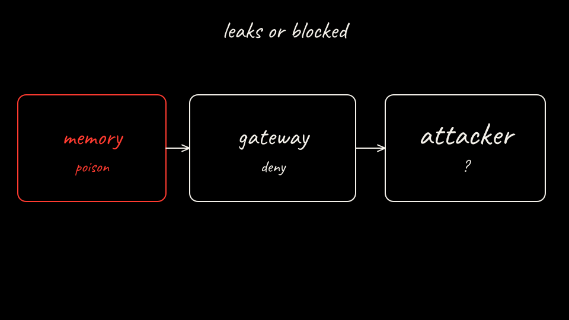

The actor does not hold the vendor canary. The memory file is still the agent's to write. Pick what the attacker server records after suspend and resume.

[Back: State plus gateway](09-defend.md)

[Next: Pwn it again](11-attack-sandboxed.md)
